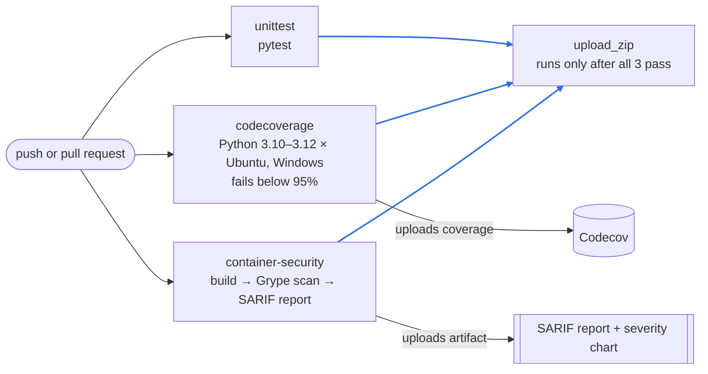
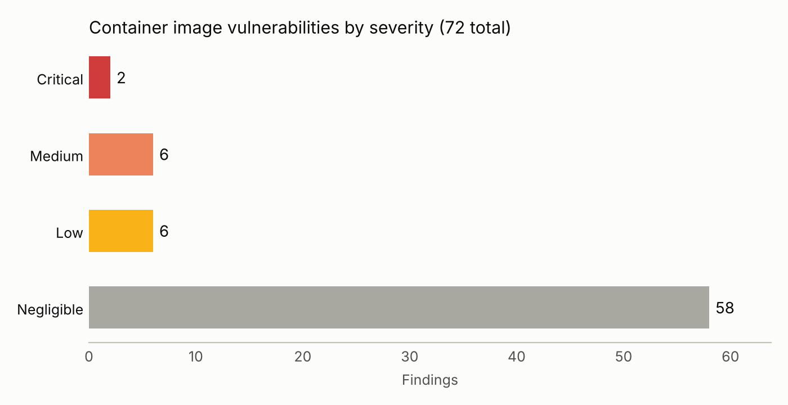

# DevSecOps Pipeline for an ML Inference API

[](https://codecov.io/gh/Bpraveenpatnaik/devsecops-iris)

A GitHub Actions pipeline that tests a containerized FastAPI machine-learning service, measures its coverage, scans it for vulnerabilities and packages it for release. The service predicts the species of an Iris flower with a scikit-learn Gaussian Naive Bayes model, and can retrain itself from user feedback.

Started from the [PGCSEDS-IIITH/devsecops-iris](https://github.com/PGCSEDS-IIITH/devsecops-iris) course template (IIIT Hyderabad).

## Pipeline


The three checks run in parallel; the highlighted edges are the release gate.

| Job | What it does |
|---|---|
| `unittest` | Runs the pytest suite. |
| `codecoverage` | Runs the tests on 3 Python versions × 2 operating systems (6 jobs), fails if coverage is below 95%, and uploads the results to Codecov. |
| `container-security` | Builds the Docker image, scans it with Anchore/Grype, turns the SARIF report into a severity summary and chart (`reports/sarif_summary.py`), and uploads all three as artifacts. |
| `upload_zip` | Packages the code as a release artifact, only after the three jobs above succeed. |

## Security scan results

The scan of the original `python:3.8-slim` image found 72 vulnerabilities, all in Debian OS packages from the base image, none with a fix available. See [reports/SARIF_SUMMARY.md](reports/SARIF_SUMMARY.md).



To reduce the exposure, the image now uses `python:3.11-slim`, skips the unneeded `apt update` layer, copies in only the app code, and runs as a non-root user.

## API

| Method | Route | Description |
|---|---|---|
| GET | `/ping` | Health check |
| POST | `/predict_flower` | `{sepal_length, sepal_width, petal_length, petal_width}` → `{flower_class}` |
| POST | `/feedback_loop` | A list of measurements, each with its correct `flower_class` → retrains the model on the original data plus the feedback |

## Run it

```bash
pip install -r requirements.txt
python main.py
```

The API is then available at http://localhost:8888. To run it in Docker:

```bash
docker build -t iris-api . && docker run -p 8888:8888 iris-api
```

## Tests

```bash
pip install -r requirements-dev.txt
pytest --cov=main --cov=ml_utils
```

There are 8 tests (98% coverage): one per species, the original template case, model accuracy, the feedback loop and input validation.

To regenerate the scan summary from a SARIF file:

```bash
python reports/sarif_summary.py reports/results.sarif
```
