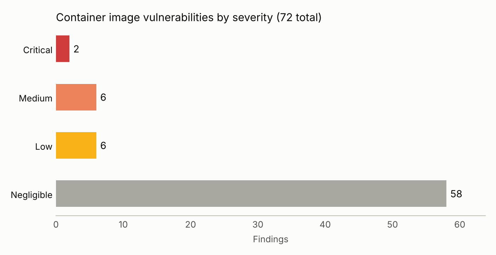

# Container Scan Summary

Anchore/Grype scan of the container image: **72 findings**, **0 with a fix available**.

| Severity | Findings |
|---|---|
| Critical | 2 |
| Medium | 6 |
| Low | 6 |
| Negligible | 58 |

## Critical and medium findings

| CVE | Severity | Package | Version | Fix |
|---|---|---|---|---|
| CVE-2021-33574 | Critical | libc-bin | 2.31-13 | none |
| CVE-2021-33574 | Critical | libc6 | 2.31-13 | none |
| CVE-2011-3389 | Medium | libgnutls30 | 3.7.1-5 | none |
| CVE-2021-37750 | Medium | libgssapi-krb5-2 | 1.18.3-6 | none |
| CVE-2021-37750 | Medium | libk5crypto3 | 1.18.3-6 | none |
| CVE-2021-37750 | Medium | libkrb5-3 | 1.18.3-6 | none |
| CVE-2021-37750 | Medium | libkrb5support0 | 1.18.3-6 | none |
| CVE-2021-40528 | Medium | libgcrypt20 | 1.8.7-6 | none |

## Takeaways

- Every finding is in a Debian OS package from the base image; none are in the application's Python code.
- No fix was available upstream for any finding when the scan ran, so the remedy is a newer, regularly rebuilt base image rather than package pinning. The Dockerfile now uses `python:3.11-slim`.
